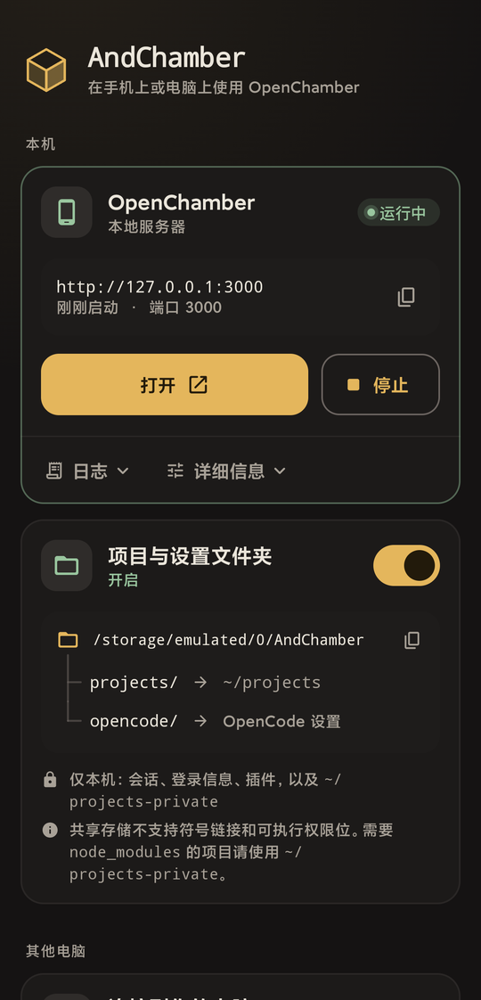
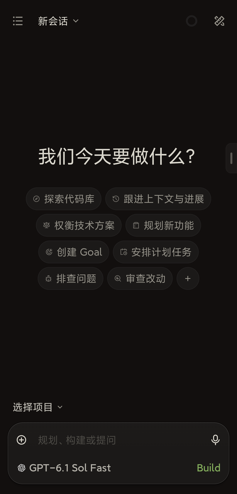
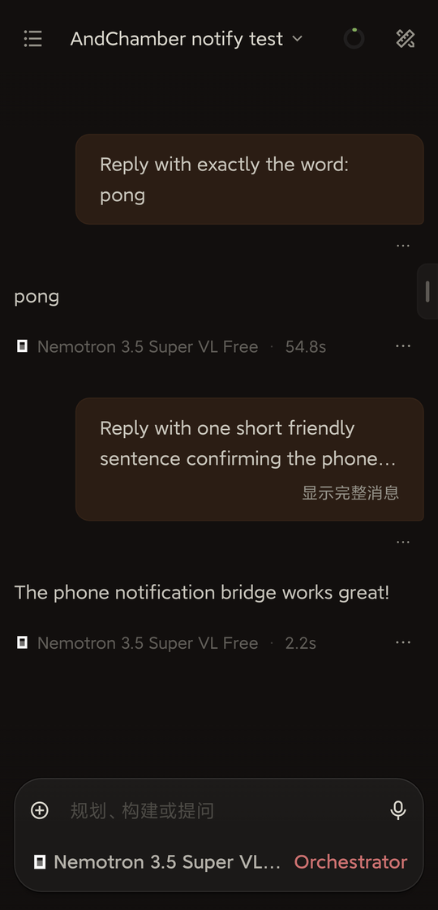

<p align="center">
  
</p>

# AndChamber

**Run [OpenChamber](https://github.com/openchamber/openchamber) (the web UI for OpenCode) natively on an Android phone — no computer, no root.**

[中文](README.md)

<p align="center">
  
  &nbsp;
  
  &nbsp;
  
</p>
<p align="center"><sub>Home: local server and project folder · OpenChamber on the phone · A session opened from a notification</sub></p>

AndChamber builds an Alpine Linux userland with PRoot inside the app's private storage, installs and runs OpenChamber and OpenCode there, and shows the local OpenChamber in a full-screen WebView. It can also connect to an OpenChamber server running on your computer.

> [!IMPORTANT]
> AndChamber is an independent open-source project, not affiliated with OpenChamber or OpenCode. Model access and authentication are handled by OpenCode and the providers you configure; AndChamber provides no model service.

## Features

- **Runs on the phone**: first-time setup downloads Alpine Linux, installs Node.js, Git, ripgrep and friends, then OpenChamber and OpenCode. After that it is one tap to start.
- **Opens straight in**: once set up, launching the app goes directly into the local OpenChamber, starting the server if needed.
- **Automatic sign-in**: the local server uses a random UI password and the app signs in for you.
- **Keeps running**: the runtime lives in a foreground service, survives backgrounding, and is restarted if it crashes.
- **Shared folder** (optional): projects and OpenCode settings live in `/sdcard/AndChamber/`, editable with a file manager or over USB. Session database, sign-ins and plugin dependencies stay private.
- **Notifications with quick replies**: when the app is in the background, OpenChamber's finished, error, question and permission notifications arrive as Android notifications. Reply, allow or deny, or answer simple questions right from the notification; tapping opens that session. AndChamber's own runtime errors are notified too.
- **English and Chinese**: the UI follows the system language.
- **Remote servers**: add the address of OpenChamber on your computer; plain HTTP needs an explicit confirmation.
- **Working terminal**: `node-pty` is rebuilt on the device for musl, so OpenChamber's terminal works.

## Requirements

| Item | Requirement |
|---|---|
| Android | 8.0 (API 26) or later |
| On-device runtime | **arm64-v8a** devices |
| x86_64 devices | Remote servers only (Android's x86_64 seccomp policy blocks `fork`, which PRoot cannot translate) |
| Storage | about 1.2 GB (download + install) |
| Network | first setup needs the Alpine mirrors and npm; Wi-Fi recommended |
| WebView | embedded pages need a system WebView with multi-profile support (`MULTI_PROFILE`). If it is missing or binding fails, the page asks you to update the WebView provider (Android System WebView or Chrome) |

## Install

Download `AndChamber-<version>.apk` from [Releases](https://github.com/doublepi123/and-chamber/releases). Each APK ships with a `.sha256` file.

## Limits and upgrade notes

- **Embedded pages need WebView multi-profile**: both the local server and remote servers require `MULTI_PROFILE`. Without it, the app does not fall back to shared cookies and the page does not load. The local background service, Home and notifications keep working.
- **Remote servers can open in an external browser**: when embedding is not available, "Open in browser" opens the saved address after URL validation, without adding passwords, cookies or tokens.
- **You may need to sign in again after upgrading**: each server uses its own WebView profile, so a new profile may ask you to sign in on first open. Server settings, passwords and old web data are kept; nothing is cleared or migrated.
- **Native downloads follow the app process**: downloads run while the app process is alive. If the process is killed, there is no resume or automatic recovery.
- **Check uncertain sends before resending**: if a notification reply or permission action ends with a timeout or interruption, the app does not resend it automatically. Open the session to check first, then resend manually if needed.
- **Cross-origin navigation opens externally**: links handled as cross-origin top-level navigation still open in the browser; requests already handled by the native downloader follow its credential-isolation rules.

## Usage

1. Open the app and tap **Set up** on the "ON THIS PHONE" card. Setup takes about 5–10 minutes and continues in the background.
2. The server starts when setup finishes; tap **Open**. From then on, launching the app goes straight in.
3. Configure a model provider in OpenChamber (Settings → Providers).

- Back inside OpenChamber goes back within the page first, then sends the app to the background (the server keeps running).
- To reach the AndChamber home screen, tap the small handle on the right edge and choose **Home**.
- "Open OpenChamber when the app starts" can be turned off under Details on the home screen.

### Shared folder

```text
/sdcard/AndChamber/
├── projects/    → ~/projects inside Linux (the home ~ is the default working directory)
├── opencode/    → OpenCode's global config folder
└── README.txt
```

`~/projects-private` is always available in shared mode for projects that need symlinks, `node_modules` or executable bits. When shared storage is off, `~/projects` is the private workspace and `~/projects-private` is not mounted.

Git repositories under `~/projects` work: AndChamber configures Git for shared storage (no symlinks, no executable bits). Run executable scripts with `sh script.sh`. `service.json` and `node_modules/` inside `opencode/` are placeholders for private binds — leave them alone. Other apps with all-files access can read this folder, so keep API keys out of config files.

## Build from source

JDK 17, Android SDK (latest Command-line Tools, platform 35, build-tools 35, NDK 29.0.14206865), Python 3.12 or later, and the host tools `make`, `patch`, `awk`, `sh`, `tar`, `xz`, `gzip` and `bzip2`. The native libraries (PRoot, talloc, libandroid-shmem) are compiled from pinned source archives; they are no longer extracted from Termux packages.

```bash
export ANDROID_HOME=$HOME/Android/Sdk
# Install the NDK (one time)
"$ANDROID_HOME/cmdline-tools/latest/bin/sdkmanager" "ndk;29.0.14206865"
# 1. Prepare native sources (network step; run before Gradle)
python3 scripts/prepare_android_runtime_sources.py --output-dir build/runtime-sources
# 2. Build and test (native compilation is offline; Maven and Google repositories still need network)
./gradlew :app:testDebugUnitTest :app:assembleDebug
python3 -m unittest discover -s scripts/tests -p 'test_*.py'   # offline tests for the build scripts
```

Step-by-step details, host-tool checks and experimental-status notes are in [docs/fdroid-source-build.md](docs/fdroid-source-build.md).

Release signing is enabled by `ANDCHAMBER_KEYSTORE_FILE`, `ANDCHAMBER_KEYSTORE_PASSWORD`, `ANDCHAMBER_KEY_ALIAS` and `ANDCHAMBER_KEY_PASSWORD` (all four required). Pushing a `v*` tag builds a signed APK on GitHub Actions and publishes a release. Before tagging, bump `andchamber.versionName` (for example `0.0.8`) and `andchamber.versionCode` (for example `8`) in `gradle.properties` so both match the tag; the tag format is `vMAJOR.MINOR.PATCH` with MINOR and PATCH between 0 and 99, and the versionCode is `MAJOR×10000 + MINOR×100 + PATCH`. The workflow checks both values before building and fails on a mismatch.

## Credits and license

- The PRoot runtime pipeline, verified downloader and atomic environment activation are ported from [AndCode](https://github.com/yuga-hashimoto/and-code) (MIT).
- The icon is redrawn from OpenChamber's cube mark.
- OpenChamber, OpenCode, Alpine Linux and other software downloaded at runtime keep their own licenses. The native components (PRoot, talloc, libandroid-shmem) are bundled in the APK, built from pinned sources, and licensed separately; see [NOTICE](NOTICE).

Released under the [MIT License](LICENSE).
