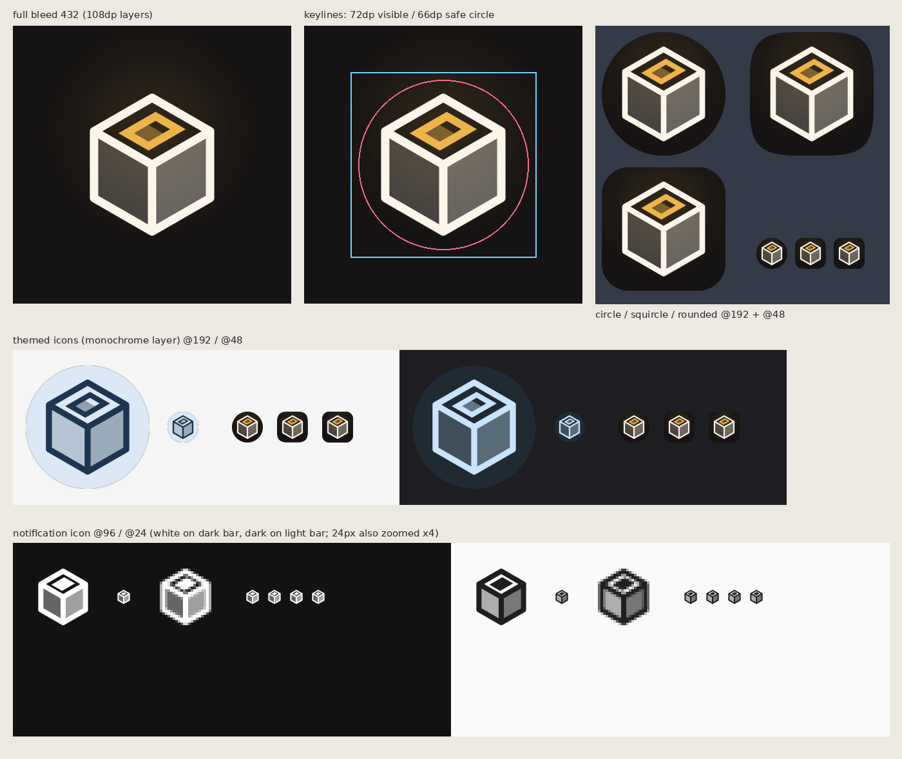

<p align="center">
  
</p>

# AndChamber

**Run [OpenChamber](https://github.com/openchamber/openchamber) (the web UI for OpenCode) natively on an Android phone — no computer, no root.**

[中文](README.md)

AndChamber builds an Alpine Linux userland with PRoot inside the app's private storage, installs and runs OpenChamber and OpenCode there, and shows the local OpenChamber in a full-screen WebView. It can also connect to an OpenChamber server running on your computer.

> [!IMPORTANT]
> AndChamber is an independent open-source project, not affiliated with OpenChamber or OpenCode. Model access and authentication are handled by OpenCode and the providers you configure; AndChamber provides no model service.

## Features

- **Runs on the phone**: first-time setup downloads Alpine Linux, installs Node.js, Git, ripgrep and friends, then OpenChamber and OpenCode. After that it is one tap to start.
- **Opens straight in**: once set up, launching the app goes directly into the local OpenChamber, starting the server if needed.
- **Automatic sign-in**: the local server uses a random UI password and the app signs in for you.
- **Keeps running**: the runtime lives in a foreground service, survives backgrounding, and is restarted if it crashes.
- **Shared folder** (optional): projects and OpenCode settings live in `/sdcard/AndChamber/`, editable with a file manager or over USB. Session database, sign-ins and plugin dependencies stay private.
- **Remote servers**: add the address of OpenChamber on your computer; plain HTTP needs an explicit confirmation.
- **Working terminal**: `node-pty` is rebuilt on the device for musl, so OpenChamber's terminal works.

## Requirements

| Item | Requirement |
|---|---|
| Android | 8.0 (API 26) or later |
| On-device runtime | **arm64-v8a** devices |
| x86_64 devices | Remote servers only (Android's x86_64 seccomp policy blocks `fork`, which PRoot cannot translate) |
| Storage | about 1.2 GB (download + install) |
| Network | first setup needs the Alpine mirrors and npm; Wi-Fi recommended |

## Install

Download `AndChamber-<version>.apk` from [Releases](https://github.com/doublepi123/and-chamber/releases). Each APK ships with a `.sha256` file.

## Usage

1. Open the app and tap **Set up** on the "ON THIS PHONE" card. Setup takes about 5–10 minutes and continues in the background.
2. The server starts when setup finishes; tap **Open**. From then on, launching the app goes straight in.
3. Configure a model provider in OpenChamber (Settings → Providers).

- Back inside OpenChamber goes back within the page first, then sends the app to the background (the server keeps running).
- To reach the AndChamber home screen, tap the small handle on the right edge and choose **Home**.
- "Open OpenChamber when the app starts" can be turned off under Details on the home screen.

### Shared folder

```text
/sdcard/AndChamber/
├── projects/    → /workspace inside Linux (default working directory)
├── opencode/    → OpenCode's global config folder
└── README.txt
```

`/workspace-private` is always available for projects that need symlinks, `node_modules` or executable bits. `service.json` and `node_modules/` inside `opencode/` are placeholders for private binds — leave them alone. Other apps with all-files access can read this folder, so keep API keys out of config files.

## Build from source

JDK 17, Android SDK (platform 35, build-tools 35) and Python 3. No NDK: PRoot and its libraries are extracted from pinned Termux packages at build time.

```bash
export ANDROID_HOME=$HOME/Android/Sdk
./gradlew :app:testDebugUnitTest :app:assembleDebug
```

Release signing is enabled by `ANDCHAMBER_KEYSTORE_FILE`, `ANDCHAMBER_KEYSTORE_PASSWORD`, `ANDCHAMBER_KEY_ALIAS` and `ANDCHAMBER_KEY_PASSWORD` (all four required). Pushing a `v*` tag builds a signed APK on GitHub Actions and publishes a release.

## Credits and license

- The PRoot runtime pipeline, verified downloader and atomic environment activation are ported from [AndCode](https://github.com/yuga-hashimoto/and-code) (MIT).
- The icon is redrawn from OpenChamber's cube mark.
- OpenChamber, OpenCode, Alpine Linux, PRoot and other software downloaded at runtime keep their own licenses; see [NOTICE](NOTICE).

Released under the [MIT License](LICENSE).
